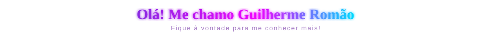

  

  
   
  FULL STACK • AUTOMAÇÃO • APRENDIZADO CONTÍNUO

 

## Sobre mim

Sou um profissional formado em Análise e Desenvolvimento de Sistemas, com foco em desenvolvimento Full Stack, otimização, automação e boas práticas.

Gosto de sempre poder me desafiar e melhorar meu conhecimento. Amo aprender coisas novas sempre que possível — nunca devemos parar de desejar crescer.

Atualmente venho praticando **Python**, **Django**, **JavaScript** e **GitHub Actions**.

 

 

<h2 align="center">Habilidades</h2>

<!-- Em breve, minhas habilidades aparecerão aqui. -->

 

<h2 align="center">Tecnologias e Ferramentas</h2>

  
   
  Python

  

  

 

<table>
  <tr>
    <td width="42%" align="center">
      
    </td>
    <td width="58%" align="center">
      <h2>🤝 Quer se conectar?</h2>
      
Fique à vontade para me chamar por aqui:

      
    </td>
  </tr>
</table>

