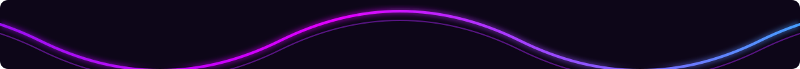
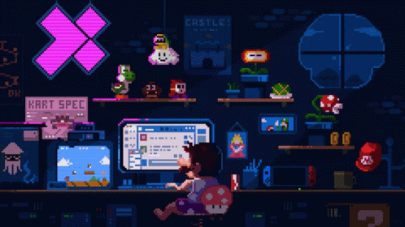

  

  

 

<table>
  <tr>
    <td width="62%" valign="top">
      <h2>💫 Sobre mim</h2>
      

        Sou um profissional formado em Análise e Desenvolvimento de Sistemas, com foco em desenvolvimento Full Stack, otimização, automação e boas práticas.
      

      

        Gosto de sempre poder me desafiar e melhorar meu conhecimento. Amo aprender coisas novas sempre que possível — nunca devemos parar de desejar crescer.
      

      

        Atualmente venho praticando <strong>Python</strong>, <strong>Django</strong>, <strong>JavaScript</strong> e <strong>GitHub Actions</strong>.
      

    </td>
    <td width="38%" align="center" valign="middle">
      
    </td>
  </tr>
</table>

 

<h2 align="center">⚡ Habilidades</h2>

<!-- Em breve, minhas habilidades aparecerão aqui. -->

 

<h2 align="center">🛠️ Tecnologias e Ferramentas</h2>

  

  

  

 

<table>
  <tr>
    <td width="42%" align="center">
      
    </td>
    <td width="58%" align="center">
      <h2>Quer se conectar?</h2>
      
Fique à vontade para me chamar por aqui:

      
    </td>
  </tr>
</table>

  

